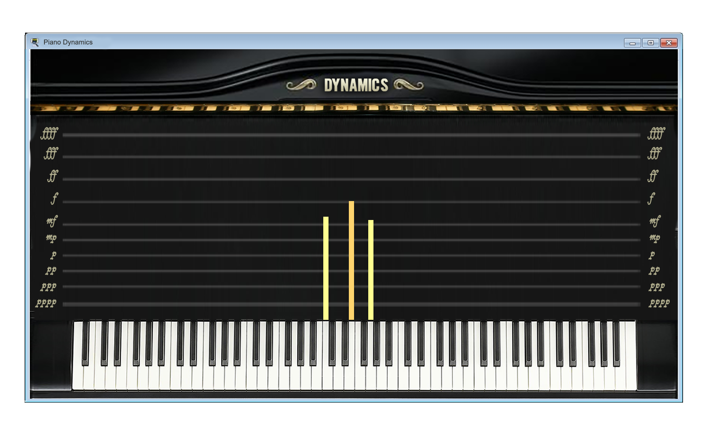

# Musical Dynamics Training Software

[](https://www.python.org/downloads/)
[](https://opensource.org/licenses/MIT)
[](https://github.com/psf/black)

A Python application that helps pianists practice and visualize their dynamic expression in real-time using MIDI input from digital pianos.

## 🎹 Features

- **Real-time Dynamics Visualization**: See your playing dynamics as colored bars above each piano key
- **Musical Notation Display**: Shows current dynamics level (pp, p, mp, mf, f, ff, etc.)
- **MIDI Input Support**: Works with any MIDI-compatible digital piano or keyboard
- **Visual Feedback**: Color-coded bars that respond to your playing intensity
- **Cross-platform**: Works on Windows, macOS, and Linux

## 🎯 Purpose

While there are many programs that help learn to play piano or improve sight-reading, few focus specifically on practicing and fine-tuning dynamic expression. This software fills that gap by providing immediate visual feedback on your dynamic control.

## 📸 Screenshots



*The application shows colored bars above each piano key indicating the velocity/dynamics of your playing.*

## 🚀 Quick Start

### Prerequisites

- Python 3.8 or higher
- A MIDI-compatible digital piano or keyboard (optional - you can use mock mode)
- MIDI drivers installed on your system (for real MIDI devices)

### Installation

1. **Clone the repository:**
   ```bash
   git clone https://github.com/scottroot/Piano-Dynamics-Midi-Trainer.git
   cd Piano-Dynamics-Midi-Trainer
   ```

2. **Install the package:**
   ```bash
   pip install -e .
   ```

### Running the Application

#### Option 1: With a Real MIDI Device

1. **Connect your MIDI device** and ensure it's recognized by your system
2. **List available MIDI ports** (optional):
   ```bash
   musical-dynamics-trainer --list-ports
   ```
3. **Run the application:**
   ```bash
   # Use default MIDI port (usually port 0)
   musical-dynamics-trainer

   # Or specify a specific port
   musical-dynamics-trainer --port 1
   ```

#### Option 2: Without a MIDI Device (Mock Mode)

Perfect for testing or when you don't have a MIDI device handy:

```bash
musical-dynamics-trainer --mock-midi
```

This will simulate MIDI input automatically, playing random notes every second so you can see how the visualization works.

#### Option 3: Try the Basic Example

Want to see the core functionality without the GUI? Run the basic usage example:

```bash
python examples/basic_usage.py
```

This demonstrates the dynamics mapping, MIDI key conversion, and color coding without needing any MIDI hardware.

### Command Line Options

```bash
# Basic usage
musical-dynamics-trainer                    # Use default MIDI port
musical-dynamics-trainer --port 1          # Use specific MIDI port
musical-dynamics-trainer --mock-midi       # Use mock MIDI (no device needed)

# Information and debugging
musical-dynamics-trainer --list-ports      # Show available MIDI ports
musical-dynamics-trainer --verbose         # Enable detailed logging
musical-dynamics-trainer --help            # Show all options
musical-dynamics-trainer --version         # Show version info
```

## 🎮 How to Use

1. **Launch the application** using one of the methods above
2. **If using a real MIDI device**: Play your piano - you'll see colored bars appear above the keys you press
3. **If using mock mode**: The app will automatically simulate playing, showing you how the visualization works
4. **Observe the dynamics** - the top of the window shows your current dynamics level
5. **Practice control** - try to maintain consistent dynamics or practice crescendos/diminuendos
6. **Press Escape** to exit the application

### Dynamics Mapping

| Velocity Range | Dynamics | Description | Color |
|---------------|----------|-------------|-------|
| 1-8 | pppp | Extremely soft | Dark blue |
| 9-31 | pp | Very soft | Blue |
| 32-53 | p/mp | Soft/Moderately soft | Light blue |
| 54-79 | mf | Moderately loud | Purple |
| 80-95 | f | Loud | Orange |
| 96-127 | ff/fff | Very loud/Extremely loud | Red |

## 🛠️ Development

### Setting Up Development Environment

1. **Clone and install development dependencies:**
   ```bash
   git clone https://github.com/scottroot/Piano-Dynamics-Midi-Trainer.git
   cd Piano-Dynamics-Midi-Trainer
   make dev-setup
   ```

2. **Run tests:**
   ```bash
   make test
   ```

3. **Check code quality:**
   ```bash
   make check
   ```

### Project Structure

```
Musical-Dynamics-Training-Software/
├── src/musical_dynamics/     # Main package
│   ├── __init__.py          # Package initialization
│   ├── __main__.py          # Command-line entry point
│   ├── config.py            # Configuration settings
│   ├── constants.py         # MIDI mappings and constants
│   ├── gui.py              # Tkinter GUI implementation
│   └── midi_handler.py     # MIDI input processing
├── tests/                   # Test suite
├── docs/                    # Documentation
├── examples/                # Usage examples
├── img/                     # Images and assets
├── pyproject.toml          # Package configuration
├── requirements.txt        # Runtime dependencies
├── requirements-dev.txt    # Development dependencies
└── README.md              # This file
```

### Available Make Commands

```bash
make help          # Show all available commands
make install       # Install package in development mode
make install-dev   # Install development dependencies
make test          # Run tests
make test-cov      # Run tests with coverage
make lint          # Run linting checks
make format        # Format code with black
make clean         # Clean build artifacts
make build         # Build package
make check         # Run all quality checks
```

## 🧪 Testing

The project includes comprehensive tests for all core functionality:

```bash
# Run all tests
pytest

# Run with coverage report
pytest --cov=musical_dynamics --cov-report=html

# Run specific test file
pytest tests/test_constants.py
```

## 🤝 Contributing

We welcome contributions! Please see our [Contributing Guidelines](CONTRIBUTING.md) for details.

### Development Workflow

1. Fork the repository
2. Create a feature branch: `git checkout -b feature/amazing-feature`
3. Make your changes and add tests
4. Run quality checks: `make check`
5. Commit your changes: `git commit -m 'Add amazing feature'`
6. Push to the branch: `git push origin feature/amazing-feature`
7. Open a Pull Request

## 📋 Requirements

### Runtime Dependencies
- `numpy>=1.18.1,<2.0.0`
- `rtmidi>=1.4.0,<2.0.0`

### Development Dependencies
- `pytest>=7.0.0,<8.0.0`
- `pytest-cov>=4.0.0,<5.0.0`
- `black>=23.0.0,<24.0.0`
- `flake8>=6.0.0,<7.0.0`
- `mypy>=1.0.0,<2.0.0`
- `pre-commit>=3.0.0,<4.0.0`

## 🐛 Troubleshooting

### Common Issues

**"No MIDI ports found"**
- Ensure your MIDI device is connected and drivers are installed
- Try running `musical-dynamics-trainer --list-ports` to see available ports
- On Windows, you may need to install ASIO drivers
- **No MIDI device?** Use `musical-dynamics-trainer --mock-midi` to test without hardware

**"Failed to open MIDI input"**
- Check that your MIDI device is not being used by another application
- Try a different MIDI port number
- Restart your MIDI device
- **Still having issues?** Try mock mode to verify the application works: `musical-dynamics-trainer --mock-midi`

**"Piano image not found"**
- The application will run without the background image
- Ensure the `img/piano_3.png` file is in the correct location

**"Application won't start"**
- Make sure you've installed the package: `pip install -e .`
- Check your Python version: `python --version` (needs 3.8+)
- Try running with verbose logging: `musical-dynamics-trainer --verbose`

### Quick Solutions

**Want to test the app without MIDI hardware?**
```bash
musical-dynamics-trainer --mock-midi
```

**Want to see what the app does without the GUI?**
```bash
python examples/basic_usage.py
```

**Having MIDI connection issues?**
1. First try: `musical-dynamics-trainer --list-ports`
2. If no ports show up, check your MIDI device drivers
3. If ports show up but connection fails, try different port numbers
4. As a last resort, use mock mode to test the application

### Getting Help

- Check the [Issues](https://github.com/scottroot/Piano-Dynamics-Midi-Trainer/issues) page
- Create a new issue with detailed information about your problem
- Include your operating system, Python version, and MIDI device information
- Try mock mode first to confirm the application works on your system

## 📄 License

This project is licensed under the MIT License - see the [LICENSE](LICENSE) file for details.

## 🙏 Acknowledgments

- **python-rtmidi**: For MIDI input handling capabilities
- **Tkinter**: For the GUI framework
- **NumPy**: For numerical operations
- **The open source community**: For inspiration and tools

## 📈 Roadmap

- [ ] Support for different piano layouts
- [ ] Recording and playback functionality
- [ ] Statistical analysis of dynamics patterns
- [ ] Customizable color schemes
- [ ] Export functionality for practice sessions
- [ ] Integration with music notation software

## 📞 Contact

- **Author**: Scott Hendrix
- **Repository**: [https://github.com/scottroot/Piano-Dynamics-Midi-Trainer](https://github.com/scottroot/Piano-Dynamics-Midi-Trainer)
- **Issues**: [https://github.com/scottroot/Piano-Dynamics-Midi-Trainer/issues](https://github.com/scottroot/Piano-Dynamics-Midi-Trainer/issues)

---

**Happy practicing! 🎹✨**
